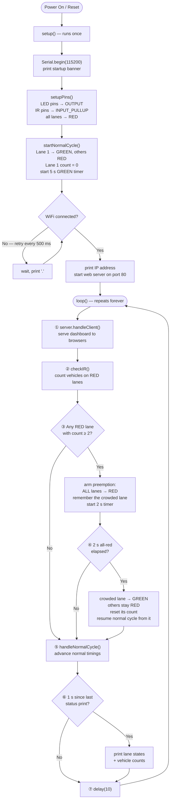
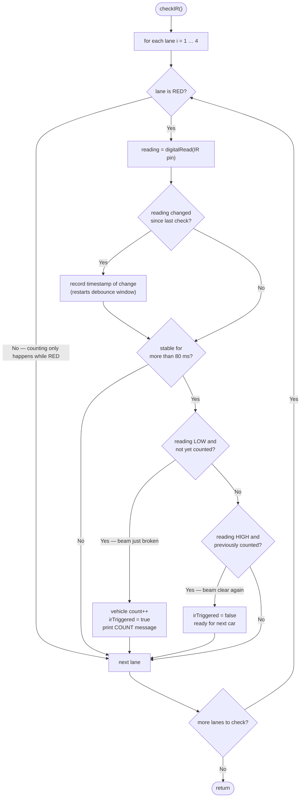
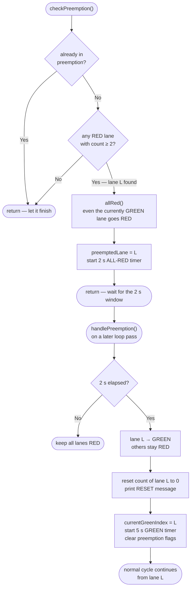
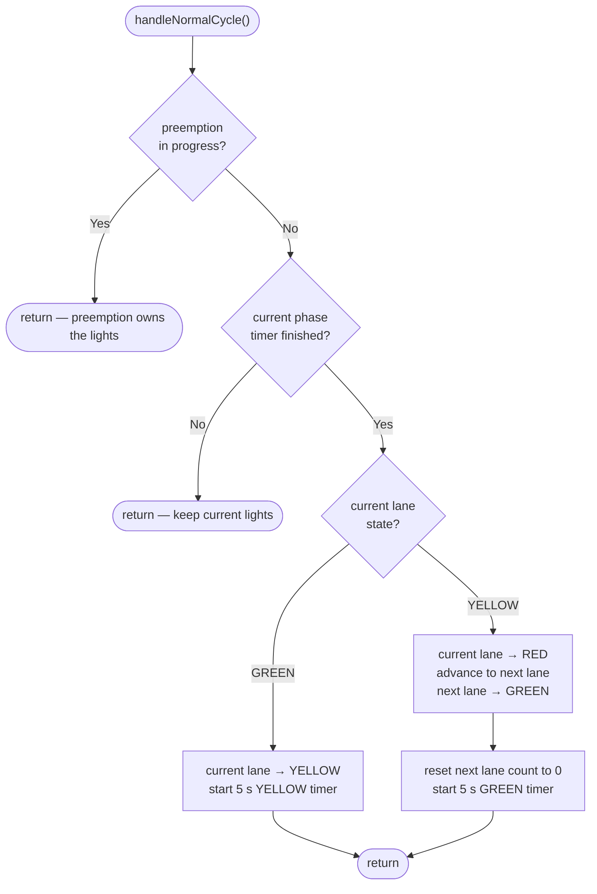
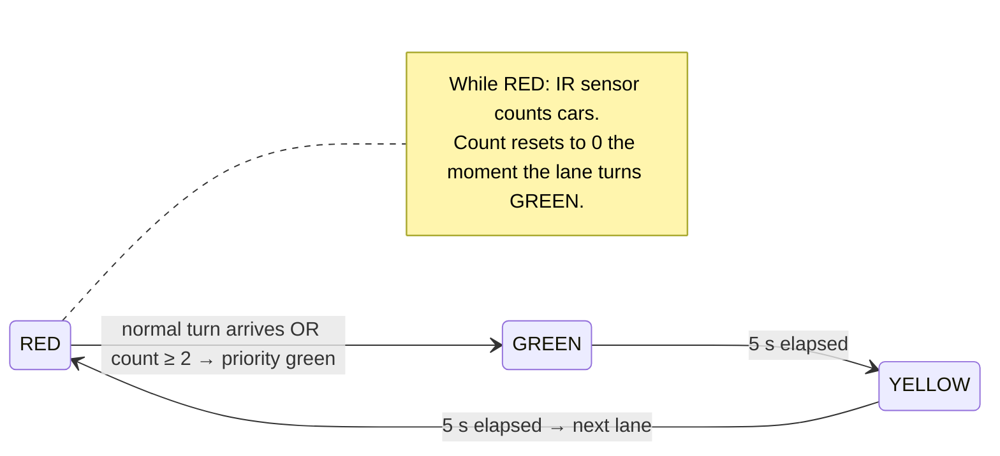

# Smart Traffic Management System — Program Flowcharts

Flowcharts for the ESP32-based adaptive traffic light controller.

## How the system works

* **Normal cycle** — each lane takes a turn: 5 s GREEN → 5 s YELLOW → RED while the next lane goes. Order: Lane 1 → 2 → 3 → 4 → 1 …
* **Vehicle counting** — while a lane is RED, its IR sensor counts vehicles passing the stop line (one count per vehicle, debounced over 80 ms).
* **Preemption** — if any RED lane accumulates ≥ 2 vehicles, the whole intersection goes ALL-RED for 2 s, then that lane gets GREEN immediately. Afterwards the normal cycle resumes from that lane.
* **Web dashboard** — the ESP32 serves a live status page on port 80 (auto-refreshes every 1 s).

Each `loop()` pass (≈ 10 ms) runs, in order:
`server.handleClient()` → `checkIR()` → `checkPreemption()` → `handlePreemption()` → `handleNormalCycle()` → periodic Serial status print.

## Contents

1. [Main program flow](#1-main-program-flow)
2. [checkIR() vehicle counting](#2-checkir-vehicle-counting)
3. [Preemption path](#3-preemption-path)
4. [handleNormalCycle() state transitions](#4-handlenormalcycle-state-transitions)
5. [Lifecycle of one lane signal](#5-lifecycle-of-one-lane-signal)

---

## 1. Main program flow

## 2. checkIR() vehicle counting

## 3. Preemption path

## 4. handleNormalCycle() state transitions

## 5. Lifecycle of one lane signal

